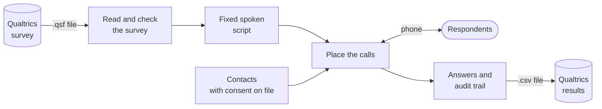
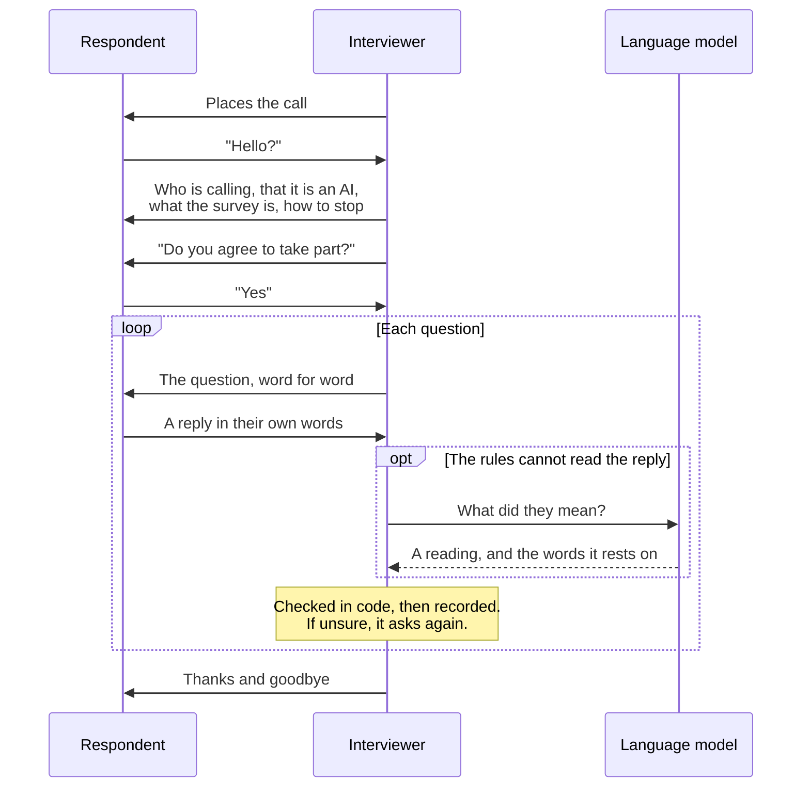

# Verity Voice

**AI voice interviewers for phone surveys, built to work with Qualtrics.**

A researcher builds a survey in Qualtrics as usual. Verity Voice phones people who have
agreed to be called, asks the questions aloud, and hands the answers back as a file that
Qualtrics imports. Qualtrics stays the system of record.

> **Status: working prototype.** The whole path has run end to end on a test survey, and
> the first real phone calls have been placed to the developer's own phone. It has not yet
> interviewed a real respondent. See [What works today](#what-works-today).

<br>

## How it works



1. **Import.** Export the survey from Qualtrics and load it with a contact list.
   Verity Voice reports whether the survey can be run by phone, and what to change if not.
2. **Call.** It phones each person, inside calling hours, and conducts the interview.
3. **Export.** It writes a response file. Import it into Qualtrics and the answers sit
   beside your web responses, marked as collected by voice.

<br>

## What happens on a call



The interviewer speaks only from a script fixed before the first call: the survey's own
wording, plus a short set of call-handling lines. A language model is used for one job,
reading what the respondent said, and its reading counts only if it names a real answer
option and the words it relied on are in the transcript.

<br>

## Safeguards

Each of these is code with a test, not a setting that can be switched off.

| Rule | What it means |
|---|---|
| **Consent on file** | Nobody is called without a record of when and how they agreed. The database itself refuses the call. |
| **AI disclosure** | The first sentence says the caller is an automated AI interviewer. |
| **Informed agreement** | Agreement is not asked for or accepted until the whole introduction has been heard. |
| **Calling hours** | 9am to 8pm in the respondent's own time zone. |
| **Opt-out** | "Remove me" ends the call at once and the number is never called again. |
| **No voicemail messages** | A machine is hung up on. |
| **Dial limit** | The server calls only numbers on an explicit allow-list. |
| **Audit trail** | Every line played, every reply heard, every reading and every decision is logged. |

<br>

## What works today

| Part | Status | Detail |
|---|---|---|
| Reading a Qualtrics survey | **Checked live** | Qualtrics' own export of the test survey is read correctly. |
| Returning results to Qualtrics | **Checked live** | A Qualtrics account imported test responses; every value landed in the right field. |
| Speaking and hearing | **Checked live** | Deepgram voice and speech recognition. |
| Reading natural answers | **Measured once** | Claude Haiku on 298 hand-written replies: 96% read acceptably, none recorded wrongly without re-asking. |
| Phone calls | **Early** | Two real calls through Telnyx to the developer's own phone. Connecting works; the conversation needed fixes, which are made but not yet retried. |
| Many calls at once | **Simulated only** | 200 people, 40 calls at a time, against a simulated phone carrier. |
| Real respondents | **Not yet** | No pilot has been run. The consent wording has had no legal review. |

The detailed, dated record is in [`voice/README.md`](voice/README.md#what-has-not-been-verified).

<br>

## Screenshots

The product interface is not built yet. These are placeholders for it.

| Campaign overview | Live calls | Results and export |
|:---:|:---:|:---:|
| _Screenshot to come_ | _Screenshot to come_ | _Screenshot to come_ |

<!--
When the screens exist, save them under docs/images/ and replace the row above:

|  |  |  |
-->

A plain test page exists for trying an interview by voice in a browser. It is a
development tool, not the product interface.

<br>

## Try it

Needs Node 22.13 or newer. Everything below runs on your own machine with no accounts or keys.

```bash
cd voice
npm ci
```

Check whether a survey is ready for the phone:

```bash
npm run verity -- check fixtures/qualtrics/library-test.qsf
```

Be interviewed in the terminal, and get the Qualtrics response file:

```bash
npm run verity -- interview fixtures/qualtrics/library-test.qsf --out responses.csv
```

Run a simulated campaign of 60 contacts and read its report:

```bash
npm run verity -- campaign sample --out sample-campaign
```

Or read the results without running anything:
[sample calls](voice/docs/sample-calls.md) ·
[sample campaign report](voice/docs/sample-campaign-report.md) ·
[sample response file](voice/docs/sample-campaign-responses.csv)

<br>

## Repository layout

```
voice/                    Verity Voice
  src/qualtrics/          reads survey files, writes the response file
  src/engine/             survey logic: skips, display rules, resuming
  src/script/             the fixed spoken script
  src/interviewer/        the interviewer: introduction, consent, reading answers
  src/voice/              speaking, listening, turn-taking
  src/telephony/          phone carrier, audio, speech recognition
  src/dialer/             contacts, consent, calling hours, campaigns
  src/quality/            outcome rates and answer-quality signals
  src/report/             survey readiness, call and campaign reports
  src/server/             web server and the browser test page
  eval/                   labelled replies, scoring, voice comparison
  test/                   automated tests
  docs/                   samples, pilot plan, set-up checklist

src/                      the original Verity web app (see below)
docs/                     write-up of the original web app
.github/workflows/        tests, deployment, scheduled checks
```

<br>

## Built with

| | |
|---|---|
| **Language** | TypeScript on Node 22 |
| **Survey platform** | Qualtrics (survey files in, response files out) |
| **Phone carrier** | Telnyx |
| **Speech** | Deepgram: Nova 3 for hearing, Aura 2 for the voice |
| **Language model** | Claude Haiku, for reading answers only |
| **Database** | Postgres |
| **Hosting** | Fly.io, deployed by GitHub Actions |

<br>

## Tests

```bash
cd voice
npm test
```

378 automated tests. Among them:

- **Nothing off-script is spoken.** Hundreds of random simulated calls, with a hostile
  stand-in for the language model, never play a line outside the fixed script.
- **Calling rules hold.** Across 5,000 random situations, never a call without consent,
  to a do-not-call number, or outside calling hours.
- **No answer is lost.** 200 people at 40 calls at a time: nobody on two calls, nothing
  lost or duplicated.
- **Real calls are replayed.** The faults found on the first answered phone call are kept
  as tests.

<br>

## Where it is going

- **More natural conversation.** Repeating a question or its answer options whenever
  asked, and understanding everyday replies such as "sure", while keeping every survey
  question word for word.
- **Choosing the voice** by comparing providers side by side.
- **A product interface** for importing a survey and contacts, watching calls, and
  exporting results. Today this is done from the command line.
- **A first pilot** with real respondents, after legal review of the consent wording.

<br>

## More to read

| Document | What it covers |
|---|---|
| [`voice/README.md`](voice/README.md) | Verity Voice in detail, including what has and has not been verified |
| [`voice-interviewer-plan.md`](voice-interviewer-plan.md) | The plan and the decisions behind it |
| [`voice/docs/what-needs-you.md`](voice/docs/what-needs-you.md) | Accounts and keys needed to run it for real |
| [`voice/docs/pilot-kit.md`](voice/docs/pilot-kit.md) | The study that would produce real accuracy numbers |

<br>

## The original Verity web app

This repository began as Verity, a web app that turns a one-sentence idea into a product
brief by asking yes-or-no questions. That app still lives at the repository root,
unchanged and separate from Verity Voice: no code is shared, and each uses its own
database. Its write-up is in [`docs/verity-web-app.md`](docs/verity-web-app.md).

<br>

## Licence

[Apache 2.0](LICENSE)
